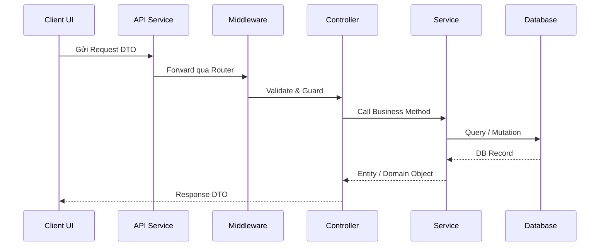

# Skill `/check-flow` — Kiểm Tra Tính Toàn Vẹn Luồng Dữ Liệu 6 Tầng

## 1. Mục Đích
Rà soát tính liên tục và đúng đắn của dòng dữ liệu từ giao diện đến cơ sở dữ liệu qua 6 tầng:
`Client UI -> BFF Proxy -> Middleware -> Controller -> Service -> Database`.
Phát hiện các điểm gãy vỡ, mismatch DTO, dead-paths hoặc thiếu sót validate.

---

## 2. Cú Pháp
```bash
/check-flow <feature-code> # Kiểm tra 1 tính năng cụ thể
/check-flow all            # Quét toàn bộ hệ thống
```

---

## 3. Quy Trình Thực Thi 4 Bước

### Bước 1: Thu Thập & Truy Vết Các Điểm Chạm (Trace Points)
1. Xác định các file liên quan:
   - **Tầng 1 (Client UI)**: Component, Form, State, Event Dispatcher.
   - **Tầng 2 (BFF / API Client)**: HTTP Interceptor, API Service, Endpoint URL.
   - **Tầng 3 (Middleware)**: Auth Guard, Rate Limiter, Validation Pipe.
   - **Tầng 4 (Controller)**: Route handler, Request Body parsing.
   - **Tầng 5 (Service / Domain Logic)**: Business Rules, Transaction.
   - **Tầng 6 (Database)**: Repository, ORM / Prisma Model, DB Table.

### Bước 2: Đánh Giá Tính Toàn Vẹn 6 Tầng
Kiểm tra từng tầng và xếp loại: `PASSED`, `WARNING`, hoặc `FAILED`.

### Bước 3: Xuất Sơ Đồ Luồng Mermaid Ra File Tài Liệu
Tạo hoặc cập nhật file tài liệu tại `docs/architecture/system-flows/[feature-code]-flow.md` (hoặc trong `technical-spec.md` của tính năng):
```markdown
# Flow Integrity Report: [FEATURE_CODE]

## 1. Sơ Đồ Luồng Xử Lý (Sequence Diagram)


## 2. Bảng Đánh Giá Tính Toàn Vẹn 6 Tầng
| Tầng | Thành phần | Trạng thái | Ghi chú |
|---|---|---|---|
| 1. Client UI | Page / Component | PASSED | Form emit đúng payload |
| 2. API Client | Http Service | PASSED | Endpoint đúng chuẩn kebab-case |
| 3. Middleware | Auth / Guard | PASSED | Token header được đính kèm |
| 4. Controller | Endpoint Route | PASSED | DTO validation đầy đủ |
| 5. Service | Domain Logic | PASSED | Xử lý transaction đúng |
| 6. Database | Schema / Query | PASSED | Index và constraints hợp lệ |
```

### Bước 4: Báo Cáo Kết Quả
Gửi đường dẫn file tài liệu `file://...` kèm kết luận ngắn gọn, súc tích.
