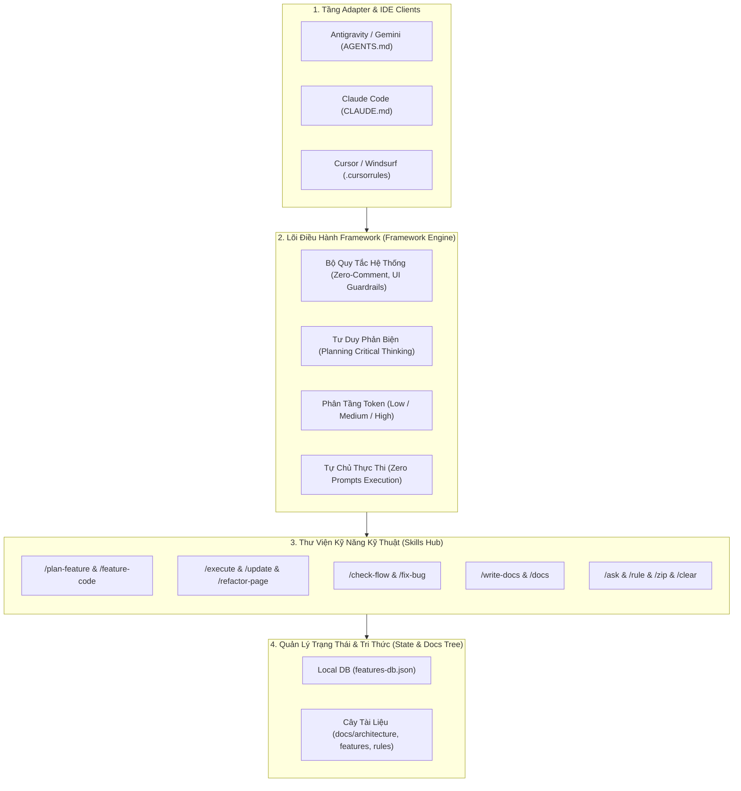

# AI Agentic Development Framework & Skills Master Specification
> **Phiên bản Portable (Xuất bản để tái sử dụng cho mọi dự án)**  
> **Áp dụng cho**: Google Antigravity / Gemini CLI, Claude Code, Cursor, Windsurf, GitHub Copilot.

---

## Mục Lục (Table of Contents)

- [1. Giới Thiệu & Triết Lý Cốt Lõi (Architecture Overview)](#1-giới-thiệu--triết-lý-cốt-lõi-architecture-overview)
- [2. Cấu Trúc Thư Mục Tiêu Chuẩn Trong Project (Standard Folder Tree)](#2-cấu-trúc-thư-mục-tiêu-chuẩn-trong-project-standard-folder-tree)
- [3. Bộ Quy Tắc Hệ Thống Bắt Buộc (Core Rules & Constraints)](#3-bộ-quy-tắc-hệ-thống-bắt-buộc-core-rules--constraints)
  - [3.1. Zero-Comment Policy (Tuyệt đối không viết comment)](#31-zero-comment-policy-tuyệt-đối-không-viết-comment)
  - [3.2. Quy chuẩn đặt tên (Naming Conventions)](#32-quy-chuẩn-đặt-tên-naming-conventions)
  - [3.3. Quy chuẩn giao diện nghiêm ngặt (Strict UI Guardrails)](#33-quy-chuẩn-giao-diện-nghiêm-ngặt-strict-ui-guardrails)
  - [3.4. Quy tắc tự chủ thực thi (Autonomous Execution & Zero Prompts)](#34-quy-tắc-tự-chủ-thực-thi-autonomous-execution--zero-prompts)
  - [3.5. Tư duy phản biện khi lập kế hoạch (Critical Planning & 5-Layer Decomposition)](#35-tư-duy-phản-biện-khi-lập-kế-hoạch-critical-planning--5-layer-decomposition)
  - [3.6. Chống chữa cháy tạm bợ & Kiểm thử E2E (Anti-Shortcut & Holistic Verification)](#36-chống-chữa-cháy-tạm-bợ--kiểm-thử-e2e-anti-shortcut--holistic-verification)
  - [3.7. Cấm tuyệt đối cơ chế Mock Fallback (Zero-Mock-Fallback Policy)](#37-cấm-tuyệt-đối-cơ-chế-mock-fallback-zero-mock-fallback-policy)
  - [3.8. Quy chuẩn phản hồi & xuất bản sơ đồ (Diagram & Output Presentation)](#38-quy-chuẩn-phản-hồi--xuất-bản-sơ-đồ-diagram--output-presentation)
  - [3.9. Phân tầng độ phức tạp & Tiết kiệm Token (Token Economy & Execution Tiering)](#39-phân-tầng-độ-phức-tạp--tiết-kiệm-token-token-economy--execution-tiering)
- [4. Động Cơ Quản Lý Tính Năng & Cây Tài Liệu (Feature DB Engine)](#4-động-cơ-quản-lý-tính-năng--cây-tài-liệu-feature-db-engine)
  - [4.1. Cây thư mục tài liệu quy chuẩn (`docs/`)](#41-cây-thư-mục-tài-liệu-quy-chuẩn-docs)
  - [4.2. Local DB Schema (`docs/features/features-db.json`)](#42-local-db-schema-docsfeaturesfeatures-dbjson)
  - [4.3. Mã nguồn công cụ tự động hóa `feature_db.py`](#43-mã-nguồn-công-cụ-tự-động-hóa-feature_dbpy)
- [5. Bộ Sưu Tập Skills Toàn Diện (Skills Inventory & Specs)](#5-bộ-sưu-tập-skills-toàn-diện-skills-inventory--specs)
  - [5.1. Nhóm Lập Kế Hoạch & Quản Lý Tính Năng (`/plan-feature`, `/execute`, `/update`, `/feature`, `/feature-code`)](#51-nhóm-lập-kế-hoạch--quản-lý-tính-năng)
  - [5.2. Nhóm Kiểm Tra, Sửa Lỗi & Tái Cấu Trúc (`/fix-bug`, `/check-flow`, `/refactor-page`)](#52-nhóm-kiểm-tra-sửa-lỗi--tái-cấu-trúc)
  - [5.3. Nhóm Tài Liệu & Đồng Bộ (`/write-docs`, `/docs`)](#53-nhóm-tài-liệu--đồng-bộ)
  - [5.4. Nhóm Quản Trị Session & Bộ Nhớ (`/ask`, `/rule`, `/zip`, `/clear`, `/start`)](#54-nhóm-quản-trị-session--bộ-nhớ)
  - [5.5. Nhóm Quan Sát UI & Chất Lượng Thiết Kế (`/watchman`, `design-taste-frontend`)](#55-nhóm-quan-sát-ui--chất-lượng-thiết-kế)
- [6. Các File Entry-Point Mẫu Cho Project Mới (Adapter Templates)](#6-các-file-entry-point-mẫu-cho-project-mới-adapter-templates)
  - [6.1. Template `AGENTS.md` (Cho Google Antigravity / Gemini CLI)](#61-template-agentsmd-cho-google-antigravity--gemini-cli)
  - [6.2. Template `CLAUDE.md` (Cho Claude Code CLI)](#62-template-claudemd-cho-claude-code-cli)
  - [6.3. Template `.cursorrules` (Cho Cursor / Windsurf)](#63-template-cursorrules-cho-cursor--windsurf)
- [7. Kịch Bản Khởi Tạo 1-Click Cho Dự Án Mới (Quick Setup Script)](#7-kịch-bản-khởi-tạo-1-click-cho-dự-án-mới-quick-setup-script)

---

## 1. Giới Thiệu & Triết Lý Cốt Lõi (Architecture Overview)

Framework này là một **Hệ Điều Hành Quy Trình Kỹ Thuật (Agentic SDLC Engine)** được thiết kế để biến các AI Coding Assistant từ trạng thái "trợ lý thụ động" thành **kỹ sư lập trình tự chủ cấp cao (Autonomous Pair Programmer)**.



### Điểm Khác Biệt Của Framework:
1. **Docs-First & Single Source of Truth**: Mọi tính năng đều bắt đầu bằng mã định danh duy nhất (`FEAT-[MODULE]-[NUMBER]`) và tài liệu kế hoạch `plan.md`. Không bao giờ code tự phát.
2. **Không Viết Comment Trong Code**: Giữ codebase sạch 100%, chống ô nhiễm mã nguồn từ AI.
3. **Thực Thi Tự Chủ Tuyệt Đối**: Khi người dùng đã duyệt plan, agent tự giải quyết toàn bộ mà không hỏi xin xác nhận từng dòng code.
4. **Chống Đi Đường Tắt & Cấm Mock Fallback**: Không chắp vá, không che giấu lỗi bằng data giả, truy vết tận gốc nguyên nhân.

---

## 2. Cấu Trúc Thư Mục Tiêu Chuẩn Trong Project (Standard Folder Tree)

Khi áp dụng Framework này vào một dự án mới (bất kể stack: Node.js, Next.js, Laravel, Django, Go, Spring Boot, React), bạn chỉ cần thiết lập cấu trúc sau tại thư mục gốc:

```
[PROJECT_ROOT]/
├── .agents/
│   ├── rules/
│   │   ├── core-system-rules.md
│   │   ├── autonomous-execution-rules.md
│   │   ├── planning-critical-thinking-rules.md
│   │   ├── anti-shortcut-and-verification-rules.md
│   │   ├── ui-form-rules.md
│   │   └── ui-filter-rules.md
│   ├── scripts/
│   │   └── feature_db.py
│   └── skills/
│       ├── ask/SKILL.md
│       ├── bug/SKILL.md
│       ├── check-flow/SKILL.md
│       ├── clear/SKILL.md
│       ├── docs/SKILL.md
│       ├── execute/SKILL.md
│       ├── feature/SKILL.md
│       ├── feature-code/SKILL.md
│       ├── fix-bug/SKILL.md
│       ├── plan-feature/SKILL.md
│       ├── refactor-page/SKILL.md
│       ├── rule/SKILL.md
│       ├── start/SKILL.md
│       ├── update/SKILL.md
│       ├── watchman/SKILL.md
│       ├── write-docs/SKILL.md
│       └── zip/SKILL.md
├── docs/
│   ├── architecture/
│   │   └── system-flows/
│   ├── features/
│   │   └── features-db.json
│   ├── rules/
│   │   └── active-rules.md
│   └── summaries/
├── AGENTS.md
├── CLAUDE.md
└── .cursorrules
```

---

## 3. Bộ Quy Tắc Hệ Thống Bắt Buộc (Core Rules & Constraints)

### 3.1. Zero-Comment Policy (Tuyệt đối không viết comment)
- **Cấm hoàn toàn mọi dạng comment**: `//`, `/* */`, `<!-- -->`, `#`, docstring nội bộ trong toàn bộ code viết mới hoặc sửa đổi.
- **Nguyên nhân**: Comment do AI sinh ra thường dài dòng, nhanh lỗi thời, gây loãng code và làm tăng chi phí token khi đọc lại context.
- **Giải pháp**: Code phải tự tường minh thông qua cấu trúc module, tên biến/hàm rõ nghĩa, khai báo kiểu dữ liệu (TypeScript Types / PHP Types) chặt chẽ. Mọi giải thích kỹ thuật phải lưu tại thư mục `docs/` hoặc xuất ra phản hồi bên ngoài.

### 3.2. Quy chuẩn đặt tên (Naming Conventions)
- **Biến & Hàm (Variables & Functions)**: Dùng `camelCase` (ví dụ: `getUserProfile`, `isAccountVerified`, `calculateTax`).
- **Class, Interface, Type**: Dùng `PascalCase` (ví dụ: `UserProfileController`, `PaymentGatewayInterface`, `OrderState`).
- **API Endpoints**: Danh từ số nhiều, chữ thường, ngăn cách bằng gạch nối `kebab-case` theo chuẩn RESTful (ví dụ: `/api/v1/user-profiles`, `/api/v1/order-items`).
- **File & Thư mục**: Dùng `kebab-case` hoặc `PascalCase` đồng nhất theo convention của từng framework kỹ thuật.

### 3.3. Quy chuẩn giao diện nghiêm ngặt (Strict UI Guardrails)
- **Cấm tùy tiện sửa UI**: Không tự ý thêm bớt component, layout, màu sắc, animation, modal ngoài yêu cầu trực tiếp.
- **No Unsolicited helperText**: Tuyệt đối không tự ý thêm dòng ghi chú `helperText` dưới các ô input/select/datepicker nếu người dùng không yêu cầu.
- **Clean Form Labels**: Không đưa chú thích `(Nội dung)` vào label trường form; không gắn icon trang trí trực tiếp lên label.
- **Toolbar & Filter Standardization**: Mọi bảng dữ liệu (DataTable) đều phải đồng bộ thanh filter gọn gàng: ô tìm kiếm, nút lọc có badge số lượng đang chọn, nút xóa bộ lọc và menu tùy biến cột. Nút hành động chính (Tạo mới) luôn nằm trên Header thanh điều hướng, không nhét vào thân bảng.

### 3.4. Quy tắc tự chủ thực thi (Autonomous Execution & Zero Prompts)
- **Không hỏi bước trung gian**: Khi người dùng đã duyệt plan hoặc gõ lệnh thực thi, agent **tuyệt đối không dừng lại để hỏi ý kiến, không xin xác nhận bước trung gian, không hỏi lựa chọn công nghệ/triển khai**.
- Agent tự động thực hiện liên tục xuyên suốt chu trình:
  `Tạo Database Schema/Migration -> Viết Backend Logic/API -> Tạo DTO/Repository Frontend -> Dựng UI Component -> Chạy Build/Test Verify -> Cập nhật Changelog Docs`.
- Agent chỉ dừng lại khi hoàn thành 100% mục tiêu, hoặc khi gặp sự cố môi trường không thể tự giải quyết.

### 3.5. Tư duy phản biện khi lập kế hoạch (Critical Planning & 5-Layer Decomposition)
- **Không chấp nhận yêu cầu thụ động**: Khi người dùng yêu cầu lập kế hoạch (`/plan-feature`), agent không gật đầu làm theo máy móc. Phải phản biện xem tính năng có cần thiết thực tế hay là "slop" (thừa thãi, làm rối UX).
- **Phân rã đệ quy 5 tầng (5-Layer Problem Decomposition)**:
  - **Tầng 0 (Bản chất nghiệp vụ)**: Xác định rõ mục tiêu cốt lõi và bài toán thực tế cần giải quyết.
  - **Tầng 1 (Quét toàn diện phạm vi)**: Kiểm kê toàn bộ thành phần liên quan (DB Schema, Repositories, Services, APIs, Frontend State, Pages, Types).
  - **Tầng 2 (Cây phụ thuộc & Tác động lan truyền)**: Đánh giá chi tiết mọi điểm đứt gãy nếu sửa đổi/xóa bỏ bất kỳ thành phần nào.
  - **Tầng 3 (Nguyên nhân gốc rễ & Giả định ngầm)**: Dùng 5 Whys, đào sâu đến tận cùng, xóa bỏ mọi hộp đen.
  - **Tầng 4 (Rủi ro & Đánh đổi kiến trúc)**: Phân định rạch ròi Must-have vs Nice-to-have/Slop, đề xuất phương án tối ưu.
  - **Tầng 5 (Phân kỳ thực thi & Kiểm chứng E2E)**: Lập các bước triển khai chi tiết, kiểm thử liên tục từng bước.

### 3.6. Chống chữa cháy tạm bợ & Kiểm thử E2E (Anti-Shortcut & Holistic Verification)
- **Cấm vá lỗi đối phó**: Không hardcode điều kiện `if/else` tạm bợ, không dùng biến cờ cục bộ để che giấu lỗi hiển thị.
- **Single Source of Truth**: Dữ liệu phải đi thông suốt từ Database qua API đến UI.
- **Kiểm thử hành trình người dùng toàn vẹn**:
  - Không coi việc "code compile thành công" là xong.
  - Phải kiểm tra: Tạo dữ liệu -> Hiển thị danh sách -> Bộ lọc -> Mở modal sửa -> Lưu trữ DB thực tế.

### 3.7. Cấm tuyệt đối cơ chế Mock Fallback (Zero-Mock-Fallback Policy)
- Cấm tạo các file mock data (`mock.ts`, `persist.ts`) để thế chỗ API thật.
- Cấm các khối `catch` tự sinh ID giả lập (`LP-XXXXXX`, `pi_mock_...`, `setIsSuccess(true)`) khi có lỗi mạng.
- Khi có lỗi, phải hiển thị thông báo lỗi trung thực để kịp thời phát hiện và xử lý.

### 3.8. Quy chuẩn phản hồi & xuất bản sơ đồ (Diagram & Output Presentation)
- Mọi nội dung giải thích có sơ đồ luồng (flowchart, sequence, architecture, data flow) **bắt buộc phải ghi thành file Markdown trong `docs/`** và gửi kèm link `file://`.
- Phản hồi ra terminal/chat phải ngắn gọn, súc tích, trực diện.

### 3.9. Phân tầng độ phức tạp & Tiết kiệm Token (Token Economy & Execution Tiering)
Khi lập kế hoạch (`/plan-feature`), agent luôn bắt buộc thẩm định và khuyến nghị cấu hình model:

| Cấp độ | Đặc điểm công việc | Model khuyến nghị | Thinking Effort | Mức tiết kiệm Token |
|:---|:---|:---|:---|:---|
| 🟢 **LOW** | Sửa text, copy, i18n, CSS, màu sắc, vị trí nút, sửa logic 1 file | `Gemini Flash` / `Flash-Lite` | Low hoặc Tắt | Tiết kiệm ~80% token |
| 🟡 **MEDIUM** | Thêm/sửa CRUD cơ bản, Modal form, kết nối API có sẵn, bộ lọc, 2-4 files | `Gemini Flash` | Tiêu chuẩn (Medium) | Tiết kiệm ~45% token |
| 🔴 **HIGH** | Auth, RBAC, Thanh toán, Migration DB lớn, tái cấu trúc luồng đa repo, lỗi ẩn race condition | `Gemini Pro` (hoặc `/boost`) | Tối đa (High) | Toàn diện, an toàn 100% |

---

## 4. Động Cơ Quản Lý Tính Năng & Cây Tài Liệu (Feature DB Engine)

### 4.1. Cây thư mục tài liệu quy chuẩn (`docs/`)
```
docs/
├── architecture/
│   └── system-flows/                   # Chứa sơ đồ luồng dữ liệu liên phân hệ
├── features/
│   ├── features-db.json                # Local Database theo dõi toàn bộ tính năng
│   └── [module-name]/
│       └── [feature-code]-[feature-slug]/
│           ├── plan.md                 # Kế hoạch triển khai & token tier
│           ├── technical-spec.md       # Đặc tả kỹ thuật & sơ đồ chi tiết
│           └── changelog.md            # Lịch sử thay đổi và bugfix
├── rules/
│   └── active-rules.md                 # Bộ nhớ quy tắc nạp động thời gian thực
└── summaries/
    └── [YYYY-MM-DD]-[session-id].md    # Bản tóm tắt phiên làm việc khi chạy /zip
```

### 4.2. Local DB Schema (`docs/features/features-db.json`)
```json
{
  "features": [
    {
      "featureCode": "FEAT-AUTH-001",
      "module": "AUTH",
      "number": 1,
      "title": "User Authentication & JWT Login",
      "slug": "user-authentication-jwt-login",
      "status": "Completed",
      "planPath": "docs/features/auth/FEAT-AUTH-001-user-authentication-jwt-login/plan.md",
      "docPath": "docs/features/auth/FEAT-AUTH-001-user-authentication-jwt-login/technical-spec.md",
      "changelogPath": "docs/features/auth/FEAT-AUTH-001-user-authentication-jwt-login/changelog.md",
      "createdAt": "2026-10-15T08:00:00",
      "updatedAt": "2026-10-15T10:30:00"
    }
  ]
}
```

### 4.3. Mã nguồn công cụ tự động hóa `feature_db.py`
Lưu file này tại `.agents/scripts/feature_db.py`. Script này dùng chuẩn Python thuần, không cần cài thư viện ngoài:

```python
import argparse
import datetime
import json
import os
import re
import sys

DB_RELATIVE_PATH = "docs/features/features-db.json"

def get_workspace_root():
    current_dir = os.path.abspath(os.getcwd())
    while current_dir != os.path.dirname(current_dir):
        if os.path.exists(os.path.join(current_dir, "WORKSPACE.md")) or os.path.exists(os.path.join(current_dir, "AGENTS.md")) or os.path.exists(os.path.join(current_dir, ".git")):
            return current_dir
        current_dir = os.path.dirname(current_dir)
    return os.path.abspath(os.getcwd())

def get_db_path():
    return os.path.join(get_workspace_root(), DB_RELATIVE_PATH)

def load_db():
    path = get_db_path()
    if not os.path.exists(path):
        os.makedirs(os.path.dirname(path), exist_ok=True)
        initial_data = {"features": []}
        with open(path, "w", encoding="utf-8") as f:
            json.dump(initial_data, f, indent=2, ensure_ascii=False)
        return initial_data
    with open(path, "r", encoding="utf-8") as f:
        try:
            return json.load(f)
        except Exception:
            return {"features": []}

def save_db(data):
    path = get_db_path()
    os.makedirs(os.path.dirname(path), exist_ok=True)
    with open(path, "w", encoding="utf-8") as f:
        json.dump(data, f, indent=2, ensure_ascii=False)

def slugify(text):
    text = text.lower().strip()
    text = re.sub(r"[^\w\s-]", "", text)
    text = re.sub(r"[\s_-]+", "-", text)
    return text.strip("-")

def get_next_feature_code(module_name):
    module_upper = module_name.upper().replace("-", "").strip()
    db = load_db()
    highest_num = 0
    pattern = re.compile(rf"^FEAT-{re.escape(module_upper)}-(\d+)$")
    for feat in db.get("features", []):
        code = feat.get("featureCode", "")
        match = pattern.match(code)
        if match:
            num = int(match.group(1))
            if num > highest_num:
                highest_num = num
    next_num = highest_num + 1
    return f"FEAT-{module_upper}-{next_num:03d}", next_num

def create_feature(module_name, title):
    feature_code, num = get_next_feature_code(module_name)
    slug = slugify(title)
    if not slug:
        slug = f"feature-{num}"
    module_slug = slugify(module_name)
    
    feature_folder = f"{feature_code}-{slug}"
    rel_feature_dir = os.path.join("docs", "features", module_slug, feature_folder)
    abs_feature_dir = os.path.join(get_workspace_root(), rel_feature_dir)
    os.makedirs(abs_feature_dir, exist_ok=True)
    
    plan_path = os.path.join(rel_feature_dir, "plan.md")
    spec_path = os.path.join(rel_feature_dir, "technical-spec.md")
    changelog_path = os.path.join(rel_feature_dir, "changelog.md")
    
    now_iso = datetime.datetime.now().strftime("%Y-%m-%dT%H:%M:%S")
    today_str = datetime.datetime.now().strftime("%Y-%m-%d")
    
    abs_plan = os.path.join(get_workspace_root(), plan_path)
    if not os.path.exists(abs_plan):
        with open(abs_plan, "w", encoding="utf-8") as f:
            f.write(f"# Implementation Plan: [{feature_code}] - {title}\n\n")
            f.write(f"- **Mã tính năng**: {feature_code}\n")
            f.write(f"- **Mục tiêu tính năng**: {title}\n")
            f.write(f"- **Trạng thái**: Planned\n")
            f.write(f"- **Ngày tạo**: {today_str}\n\n---\n\n")
            f.write("### 🎯 KHUYẾN NGHỊ CHẾ ĐỘ THỰC THI (TOKEN ECONOMY)\n")
            f.write("- **Độ phức tạp task**: [ 🟢 LOW | 🟡 MEDIUM | 🔴 HIGH ]\n")
            f.write("- **Cấu hình tối ưu**: [ Model: Gemini Flash-Lite / Flash / Pro ] | [ Thinking: Low / Medium / High ]\n")
            f.write("- **Lý do**: [ Phân tích ngắn gọn phạm vi file, rủi ro database / logic nghiệp vụ ]\n\n---\n\n")
            f.write("## 1. Danh Sách File Cần Chỉnh Sửa / Tạo Mới (File Matrix)\n\n")
            f.write("| Đường dẫn file | Phân loại | Trách nhiệm chính |\n")
            f.write("|---|---|---|\n\n---\n\n")
            f.write("## 2. Phương Án Kỹ Thuật (Data -> Logic -> UI)\n\n")

    abs_spec = os.path.join(get_workspace_root(), spec_path)
    if not os.path.exists(abs_spec):
        with open(abs_spec, "w", encoding="utf-8") as f:
            f.write(f"# Technical Specification: [{feature_code}] - {title}\n\n")
            f.write(f"- **Mã tính năng**: {feature_code}\n\n## 1. Luồng Xử Lý (Sequence Flow)\n\n")

    abs_changelog = os.path.join(get_workspace_root(), changelog_path)
    if not os.path.exists(abs_changelog):
        with open(abs_changelog, "w", encoding="utf-8") as f:
            f.write(f"# Changelog: [{feature_code}] - {title}\n\n")
            f.write(f"## [{today_str}] Khởi tạo kế hoạch tính năng\n- Tạo tài liệu plan.md và technical-spec.md.\n")

    db = load_db()
    record = {
        "featureCode": feature_code,
        "module": module_name.upper().strip(),
        "number": num,
        "title": title,
        "slug": slug,
        "status": "Planned",
        "planPath": plan_path,
        "docPath": spec_path,
        "changelogPath": changelog_path,
        "createdAt": now_iso,
        "updatedAt": now_iso
    }
    db["features"].append(record)
    save_db(db)
    
    print(json.dumps(record, indent=2, ensure_ascii=False))
    return record

def get_feature(feature_code):
    db = load_db()
    for feat in db.get("features", []):
        if feat.get("featureCode", "").upper() == feature_code.upper():
            print(json.dumps(feat, indent=2, ensure_ascii=False))
            return feat
    print(f"Error: Feature '{feature_code}' not found.", file=sys.stderr)
    sys.exit(1)

def update_status(feature_code, new_status):
    db = load_db()
    found = False
    for feat in db.get("features", []):
        if feat.get("featureCode", "").upper() == feature_code.upper():
            feat["status"] = new_status
            feat["updatedAt"] = datetime.datetime.now().strftime("%Y-%m-%dT%H:%M:%S")
            found = True
            break
    if found:
        save_db(db)
        print(f"Success: {feature_code} status updated to '{new_status}'")
    else:
        print(f"Error: Feature '{feature_code}' not found.", file=sys.stderr)
        sys.exit(1)

def search_features(query, code_only=False):
    db = load_db()
    query_lower = query.lower()
    matches = []
    for feat in db.get("features", []):
        if query_lower in feat.get("featureCode", "").lower() or query_lower in feat.get("title", "").lower() or query_lower in feat.get("slug", "").lower():
            matches.append(feat)
    if code_only:
        if matches:
            print(matches[0].get("featureCode"))
        return
    print(json.dumps(matches, indent=2, ensure_ascii=False))

def main():
    parser = argparse.ArgumentParser(description="Feature DB Manager CLI")
    subparsers = parser.add_subparsers(dest="command")

    create_parser = subparsers.add_parser("create")
    create_parser.add_argument("--module", required=True, help="Module name (e.g. AUTH, ORDER)")
    create_parser.add_argument("--title", required=True, help="Feature title")

    get_parser = subparsers.add_parser("get")
    get_parser.add_argument("feature_code", help="Feature Code (e.g. FEAT-AUTH-001)")

    status_parser = subparsers.add_parser("update-status")
    status_parser.add_argument("feature_code", help="Feature Code")
    status_parser.add_argument("status", choices=["Planned", "In-Progress", "Completed", "Archived"])

    search_parser = subparsers.add_parser("search")
    search_parser.add_argument("query", help="Keyword to search")
    search_parser.add_argument("--code-only", action="store_true", help="Print only feature code")

    args = parser.parse_args()
    if args.command == "create":
        create_feature(args.module, args.title)
    elif args.command == "get":
        get_feature(args.feature_code)
    elif args.command == "update-status":
        update_status(args.feature_code, args.status)
    elif args.command == "search":
        search_features(args.query, code_only=args.code_only)
    else:
        parser.print_help()

if __name__ == "__main__":
    main()
```

---

## 5. Bộ Sưu Tập Skills Toàn Diện (Skills Inventory & Specs)

Mỗi Skill được lưu tại `.agents/skills/[skill-name]/SKILL.md` kèm metadata YAML frontmatter.

### 5.1. Nhóm Lập Kế Hoạch & Quản Lý Tính Năng

#### 1. Skill `/plan-feature` (`.agents/skills/plan-feature/SKILL.md`)
- **Mục đích**: Khảo sát nghiệp vụ, tự động sinh mã `FEAT-[MODULE]-[NUMBER]`, thẩm định Token Tiering và xuất bản kế hoạch chuẩn tại `docs/features/[module]/[code]-[slug]/plan.md`.
- **Workflow**:
  ```mermaid
  flowchart TD
      A["/plan-feature <Tên Tính Năng>"] --> B["1. Tự động sinh mã tính năng qua feature_db.py"]
      B --> C["2. Khảo sát docs/ & Schema/Codebase hiện có"]
      C --> D["3. Phân rã 5 tầng & Thẩm định Token Tiering (Low/Medium/High)"]
      D --> E["4. Xuất bản plan.md & technical-spec.md"]
      E --> F["5. Báo cáo kế hoạch kèm file:// link"]
  ```

#### 2. Skill `/execute` (`.agents/skills/execute/SKILL.md`)
- **Mục đích**: Hiện thực hóa mã nguồn từ `plan.md` thành code thực tế theo 3 tầng (Database $\rightarrow$ Backend Logic $\rightarrow$ Frontend UI), tuân thủ nghiêm ngặt Zero-Comment và cập nhật trạng thái Local DB thành `Completed`.
- **Workflow**:
  ```mermaid
  flowchart TD
      A["/execute <feature-code>"] --> B["1. Đọc plan.md & Cập nhật Local DB -> In-Progress"]
      B --> C["2. Triển khai tuần tự: DB -> Logic -> UI"]
      C --> D["3. Chạy lệnh kiểm thử tự động (Build / Typecheck / Tests)"]
      D --> E["4. Cập nhật Local DB -> Completed & changelog.md"]
      E --> F["5. Báo cáo danh sách file hoàn thành"]
  ```

#### 3. Skill `/update` (`.agents/skills/update/SKILL.md`)
- **Mục đích**: Nâng cấp, mở rộng tính năng đã tồn tại. Phân tích tác động lan truyền (Impact Analysis) đến các callers/consumers, cập nhật code và đồng bộ hóa `technical-spec.md` và `changelog.md`.

#### 4. Skill `/feature` (`.agents/skills/feature/SKILL.md`)
- **Mục đích**: Phát triển tính năng mới tổng quát, kết nối sâu chuỗi các thao tác: Khảo sát thầm lặng (Silent Survey) $\rightarrow$ Thiết kế hợp đồng dữ liệu DTO/API $\rightarrow$ Triển khai code $\rightarrow$ Kiểm thử.

#### 5. Skill `/feature-code` (`.agents/skills/feature-code/SKILL.md`)
- **Mục đích**: Tra cứu tức thì mã định danh tính năng. Chạy `python3 .agents/scripts/feature_db.py search "<keyword>" --code-only`.
- **Yêu cầu đặc biệt**: Trả về DUY NHẤT chuỗi mã tính năng (ví dụ `FEAT-AUTH-001`), không kèm văn bản thừa.

---

### 5.2. Nhóm Kiểm Tra, Sửa Lỗi & Tái Cấu Trúc

#### 6. Skill `/fix-bug` (Alias: `/bug`) (`.agents/skills/fix-bug/SKILL.md`)
- **Mục đích**: Định vị nguyên nhân gốc rễ và sửa lỗi dứt điểm theo phân loại:
  - `/fix-bug ui <feature-code>`: Sửa lỗi layout, CSS, render. Tuyệt đối không thêm bớt component, layout, màu sắc hay helperText ngoài phạm vi sửa lỗi.
  - `/fix-bug logic <feature-code>`: Sửa lỗi thuật toán, race condition, validate, API query.
- **Workflow**:
  ```mermaid
  flowchart TD
      A["/fix-bug <ui | logic> <feature-code>"] --> B["1. Phân tích Root Cause qua Log & Code"]
      B --> C{"Phân loại lỗi"}
      C -->|ui| D["Khắc phục vỡ layout/CSS (Giữ nguyên cấu trúc gốc)"]
      C -->|logic| E["Sửa thuật toán / Query / Validate (Zero-Comment)"]
      D --> F["2. Chạy Build / Verify xác minh dứt điểm lỗi"]
      E --> F
      F --> G["3. Ghi chép Root Cause & Fix vào changelog.md"]
  ```

#### 7. Skill `/check-flow` (`.agents/skills/check-flow/SKILL.md`)
- **Mục đích**: Kiểm tra tính toàn vẹn của luồng xử lý từ Client UI $\rightarrow$ BFF Proxy $\rightarrow$ Middleware $\rightarrow$ Controller $\rightarrow$ Service $\rightarrow$ Database.
- **Tham số**:
  - `<feature-code>`: Kiểm tra 1 tính năng cụ thể.
  - `all`: Quét toàn bộ route hệ sinh thái tìm dead-paths hoặc mismatch.
- **Output**: Xuất sơ đồ Mermaid Sequence Diagram và Bảng Đánh Giá Tính Toàn Vẹn 6 tầng (`PASSED` / `WARNING` / `FAILED`).

#### 8. Skill `/refactor-page` (`.agents/skills/refactor-page/SKILL.md`)
- **Mục đích**: Tái cấu trúc file monolithic page (hàng trăm dòng) thành thư mục module hóa sạch sẽ:
  ```
  src/pages/<PageName>/
  ├── <PageName>.tsx        # Page chính điều phối (Orchestrator)
  ├── index.ts              # Re-export giữ 100% tương thích router
  └── components/           # Thư mục sub-components độc lập
      ├── <PageName>FilterBar.tsx
      ├── <PageName>CreateModal.tsx
      └── index.ts
  ```
- **Cam kết**: Zero Regression (giữ nguyên 100% giao diện và nghiệp vụ), TypeScript Strict Props.

---

### 5.3. Nhóm Tài Liệu & Đồng Bộ

#### 9. Skill `/write-docs` (`.agents/skills/write-docs/SKILL.md`)
- **Mục đích**: Tạo mới hoặc chuẩn hóa bộ 3 tài liệu (`plan.md`, `technical-spec.md`, `changelog.md`) cho tính năng hoặc chuẩn hóa tài liệu hệ thống (`system`). Đảm bảo toàn bộ tài liệu nằm đúng cây thư mục `docs/`.

#### 10. Skill `/docs` (`.agents/skills/docs/SKILL.md`)
- **Mục đích**: Cổng đồng bộ và quét kiểm tra toàn diện cây tài liệu dự án, đảm bảo không có file tài liệu mồ côi ngoài cấu trúc quy chuẩn.

---

### 5.4. Nhóm Quản Trị Session & Bộ Nhớ

#### 11. Skill `/ask` (`.agents/skills/ask/SKILL.md`)
- **Mục đích**: Truy vấn kỹ thuật, tư vấn kiến trúc ở **Chế độ Cách Ly (Isolated Mode)**.
- **Đặc tính**: Không làm thay đổi Session State, không ô nhiễm ngữ cảnh (Zero Context Pollution), chỉ đọc (Read-only).

#### 12. Skill `/rule` (`.agents/skills/rule/SKILL.md`)
- **Mục đích**: Thẩm định và nạp động quy tắc mới vào bộ nhớ active của agent và tự động ghi vào `docs/rules/active-rules.md`.
- **Thẩm định**: Từ chối áp dụng nếu quy tắc mới mâu thuẫn với 3 quy tắc cốt lõi ban đầu.

#### 13. Skill `/zip` (`.agents/skills/zip/SKILL.md`)
- **Mục đích**: Đóng gói và lưu trữ toàn bộ quyết định kỹ thuật, file đã sửa đổi và pending tasks của phiên làm việc thành file `docs/summaries/[YYYY-MM-DD]-[session-id].md`. Giúp người dùng có thể an tâm chạy `/clear` để giải phóng ngữ cảnh.

#### 14. Skill `/clear` (Alias: `/reset`) (`.agents/skills/clear/SKILL.md`)
- **Mục đích**: Xả sạch bộ nhớ ngữ cảnh trao đổi, đưa agent về trạng thái sạch sẽ ban đầu (Clean Slate), loại bỏ mọi giả định tạm thời.

#### 15. Skill `/start` (`.agents/skills/start/SKILL.md`)
- **Mục đích**: Khởi tạo và nạp ngữ cảnh dự án, kiểm tra phiên bản Framework, báo cáo health check hệ thống và gửi lời chào kích hoạt.

---

### 5.5. Nhóm Quan Sát UI & Chất Lượng Thiết Kế

#### 16. Skill `/watchman` (`.agents/skills/watchman/SKILL.md`)
- **Mục đích**: Điều khiển **Watchman MCP** (Passive UI Observer) khởi chạy Chromium headed có nhúng In-Browser HUD, tự động ghi nhận Dual-Snapshot, network telemetry và console logs để điều tra UI bug.
- **Cú pháp**: `/watchman <host> run` (ví dụ `/watchman http://localhost:3000 run`).

#### 17. Skill `design-taste-frontend` (`.agents/skills/design-taste-frontend/SKILL.md`)
- **Mục đích**: Chống thiết kế generic/slop, áp dụng Art Direction chuẩn từ các gallery đoạt giải (Awwwards, One Page Love) cho typography, bảng màu, composition và visual rhythm.

---

## 6. Các File Entry-Point Mẫu Cho Project Mới (Adapter Templates)

### 6.1. Template `AGENTS.md` (Cho Google Antigravity / Gemini CLI)
Đặt file này tại thư mục gốc của dự án (`AGENTS.md`):

```markdown
# AGENTS.md (Workspace Root — Antigravity / Gemini Entry Point)

## 1. NGUYÊN TẮC CỐT LÕI & QUY CHUẨN BẮT BUỘC (SYSTEM RULES)

1. **Tuyệt đối không viết comment trong code (Zero-Comment Policy)**:
   - Cấm hoàn toàn mọi dạng comment trong toàn bộ mã nguồn. Code phải tự tường minh.
   - Mọi phân tích, giải thích kỹ thuật phải lưu tại docs/.
   - Chi tiết: .agents/rules/core-system-rules.md, docs/rules/active-rules.md.

2. **Quy chuẩn đặt tên (Naming Conventions)**:
   - Biến & hàm: camelCase.
   - Class, Interface, Type: PascalCase.
   - RESTful API: kebab-case số nhiều (/api/v1/user-profiles).
   - File & Folder: Nhất quán theo kiến trúc dự án.

3. **Cấm tùy tiện sửa đổi hoặc bổ sung UI (Strict UI Guardrails)**:
   - Không tự ý thêm bớt component, layout, màu sắc, animation, modal.
   - No Unsolicited helperText: Tuyệt đối không tự ý thêm helperText.
   - Filter Bar & Toolbar Standardization: Đồng bộ cấu trúc thanh filter gọn gàng.

4. **Quy chuẩn phản hồi & xuất bản sơ đồ**:
   - Mọi giải thích kèm sơ đồ luồng bắt buộc lưu vào docs/ và dẫn link file://.

## 2. QUY CHUẨN QUẢN LÝ TÍNH NĂNG (DOCS TREE)

- Định dạng Feature Code: FEAT-[MODULE]-[NUMBER] (Ví dụ: FEAT-AUTH-001).
- Quản lý qua Local DB docs/features/features-db.json và script .agents/scripts/feature_db.py.
- Cây tài liệu chuẩn:
  docs/features/[module]/[feature-code]-[slug]/ (plan.md, technical-spec.md, changelog.md).

## 3. BỘ LỆNH ĐIỀU HÀNH (SKILLS)

- /plan-feature <Tên Tính Năng>: Lập kế hoạch, cấp phát mã tính năng, đánh giá Token Tier.
- /execute <feature-code>: Triển khai code tự chủ, zero-comment.
- /fix-bug <ui | logic> <feature-code>: Sửa lỗi phân loại, cập nhật changelog.
- /update <feature-code>: Cập nhật tính năng & phân tích tác động lan truyền.
- /check-flow [feature-code | all]: Kiểm tra luồng dữ liệu 6 tầng.
- /write-docs [feature-code | system]: Chuẩn hóa tài liệu.
- /refactor-page <path>: Tái cấu trúc monolithic page thành module sạch.
- /feature-code <keyword>: Tra cứu mã tính năng.
- /ask <câu hỏi>: Hỏi đáp ở chế độ cách ly.
- /rule <quy tắc>: Nạp động quy tắc mới.
- /zip: Tóm tắt phiên làm việc trước khi clear context.
- /clear: Làm mới bộ nhớ ngữ cảnh.
- /start: Khởi tạo workspace.

## 4. QUY TẮC THỰC THI TỰ CHỦ & TƯ DUY PHẢN BIỆN

- Tư duy phản biện khi lập Plan: Chất vấn tính cần thiết, loại bỏ slop, phân rã 5 tầng.
- Không hỏi lại khi đang làm (Zero Unnecessary Prompts): Làm liên tục từ đầu đến cuối sau khi plan được duyệt.
- Chống đi đường tắt & Zero-Mock-Fallback: Cấm chữa cháy tạm bợ, cấm sinh dữ liệu giả khi lỗi mạng.
```

### 6.2. Template `CLAUDE.md` (Cho Claude Code CLI)
Đặt file này tại thư mục gốc của dự án (`CLAUDE.md`):

```markdown
# CLAUDE.md

## Core Rules & Conventions
1. **Zero-Comment Policy**: Tuyệt đối không viết comment trong code (cấm //, /* */, <!-- -->, #, docstrings). Code phải tự tường minh.
2. **Naming Conventions**: camelCase cho biến/hàm, PascalCase cho Class/Type, kebab-case cho RESTful API.
3. **Strict UI Guardrails**: Không tự ý thêm layout, component, modal hay helperText. Mọi thay đổi UI phải có yêu cầu trực tiếp.
4. **Autonomous Execution**: Khi đã nhận yêu cầu hoặc duyệt plan, tự chủ ra quyết định kỹ thuật và thực thi liên tục từ đầu đến cuối, không dừng lại hỏi bước trung gian.
5. **Feature Code & Docs**: Định dạng FEAT-[MODULE]-[NUMBER], quản lý qua docs/features/features-db.json và .agents/scripts/feature_db.py.

## Commands & Skills
- /plan-feature: Lên kế hoạch & thẩm định Token Tiering
- /execute: Triển khai code chuẩn
- /fix-bug: Sửa lỗi phân loại ui/logic
- /update: Cập nhật & kiểm tra lan truyền
- /check-flow: Kiểm tra toàn vẹn luồng dữ liệu
- /refactor-page: Module hóa monolithic page
- /ask, /rule, /zip, /clear, /start
```

### 6.3. Template `.cursorrules` (Cho Cursor / Windsurf)
Đặt file này tại thư mục gốc của dự án (`.cursorrules`):

```markdown
# Cursor Rules — Agentic Engineering SDLC

You must strictly adhere to the following core system rules on every task:

1. Zero-Comment Policy:
   Never write any comments in source code (no //, /* */, #, <!-- -->).
   Code must be 100% self-documenting through clean naming, interfaces, and architecture.
   Place technical explanations in docs/ or in your external chat response.

2. Naming Conventions:
   - camelCase for variables and functions.
   - PascalCase for Classes, Interfaces, and Types.
   - kebab-case for REST API endpoints (/api/v1/resource-items).

3. Strict UI Guardrails:
   - Never add unsolicited components, animations, styles, or helperText to form fields.
   - Standardize all table filter toolbars.

4. Autonomous Execution:
   - Once a task or plan is confirmed, execute continuously from Database to Logic to UI to Test.
   - Do not stop to ask trivial confirmation prompts.

5. Feature Code & Docs Standard:
   - Always reference features by their unique FEAT-[MODULE]-[NUMBER] identifier.
   - Maintain docs at docs/features/[module]/[feature-code]-[slug]/ (plan.md, technical-spec.md, changelog.md).
```

---

## 7. Kịch Bản Khởi Tạo 1-Click Cho Dự Án Mới (Quick Setup Script)

Để thiết lập toàn bộ bộ khung Framework này trong bất kỳ project nào mới chỉ trong 5 giây, hãy tạo và chạy script sau tại thư mục gốc của dự án mới:

```bash
#!/usr/bin/env bash
set -e

echo "🚀 Bắt đầu khởi tạo AI Agentic Engineering Framework..."

# 1. Tạo cây thư mục chuẩn
mkdir -p .agents/rules .agents/scripts .agents/skills docs/architecture/system-flows docs/features docs/rules docs/summaries

# 2. Tạo file features-db.json ban đầu
cat << 'EOF' > docs/features/features-db.json
{
  "features": []
}
EOF

# 3. Tạo file active-rules.md ban đầu
cat << 'EOF' > docs/rules/active-rules.md
# Active Rules & System Constraints

## I. Ba Nguyên Tắc Cốt Lõi Bắt Buộc
1. Tuyệt đối không viết comment trong code (Zero-Comment Policy).
2. Quy chuẩn đặt tên: camelCase (biến/hàm), PascalCase (Class/Type), kebab-case (REST API).
3. Cấm tùy tiện sửa đổi hoặc bổ sung UI (Strict UI Guardrails, No Unsolicited helperText).

## II. Quy Tắc Tự Chủ & Thực Thi
- Không hỏi lại khi đang làm (Zero Unnecessary Prompts).
- Chống đi đường tắt, cấm chữa cháy tạm bợ & Single Source of Truth.
- Tuyệt đối cấm toàn bộ cơ chế Mock Fallback.
EOF

echo "✅ Đã tạo cấu trúc thư mục và tài liệu cốt lõi!"
echo "👉 Bước tiếp theo: Copy file .agents/scripts/feature_db.py và các skills vào .agents/skills/ theo tài liệu này!"
```

---
*Tài liệu này là bản đặc tả đầy đủ nhất của AI Framework, sẵn sàng lưu trữ và áp dụng ngay cho bất kỳ dự án phần mềm nào.*
