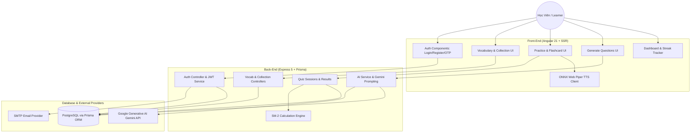

# System Flow Overview (Tổng Thể Toàn Hệ Thống Memofit)

> **Hệ thống**: Memofit — Spaced Repetition Learning & AI Question Generation  
> **Kiến trúc**: Multi-Tier Architecture (Client SPA/SSR Angular 21 $\leftrightarrow$ REST API Express 5 $\leftrightarrow$ PostgreSQL / Prisma $\leftrightarrow$ Gemini AI & TTS)

---

## 1. TỔNG QUAN TÁC NHÂN & HỆ THỐNG (ACTORS & COMPONENTS)



---

## 2. LUỒNG DỮ LIỆU CỐT LÕI (CORE EXECUTION FLOWS)

### 2.1. Luồng Xác Thực & Cấp Phát JWT (Authentication Flow)
1. Học viên gửi yêu cầu đăng ký/đăng nhập từ Frontend.
2. Backend kiểm tra tài khoản, hash password với `bcrypt`.
3. Khi đăng ký mới: Backend sinh OTP 6 số và gửi mail qua `nodemailer`.
4. Khi đăng nhập thành công: Backend cấp JWT Access Token và Refresh Token.
5. Frontend lưu trữ token qua Interceptor và tự động gắn header `Authorization: Bearer <token>` cho mọi request sau đó.

### 2.2. Luồng Quản Lý Từ Vựng & Sinh Câu Hỏi Tự Động Bằng AI
1. Học viên tạo Bộ từ vựng (`collections`) và thêm các từ vựng (`vocabularies`) hoặc tải lên qua file Excel (`exceljs`).
2. Yêu cầu sinh câu hỏi trắc nghiệm/điền từ được gửi tới `POST /api/questions/generate-ai`.
3. `ai.service.js` nạp danh sách từ vựng, tạo structured prompt gửi tới Google Gemini API (`@google/generative-ai`).
4. Gemini sinh câu hỏi theo chuẩn JSON (gồm câu hỏi, đáp án đúng, 3 lựa chọn gây nhiễu, giải thích ngữ cảnh).
5. Backend validate kết quả qua Zod, lưu vào bảng `questions` và liên kết với từ vựng.

### 2.3. Luồng Luyện Tập & Thuật Toán Lặp Lại Ngắt Quãng SuperMemo-2 (SM-2)
1. Học viên bắt đầu phiên học flashcard/quiz (`/practice`).
2. Hệ thống truy vấn các từ vựng cần ôn tập dựa trên `next_review_date <= NOW()`.
3. Học viên đánh giá mức độ nhớ theo thang điểm Quality (0 - 5):
   - **5 - Hoàn hảo**: Nhớ ngay lập tức.
   - **4 - Tốt**: Nhớ sau một chút do dự.
   - **3 - Đạt**: Nhớ được nhưng mất nhiều công sức.
   - **2 - Sai**: Đoán sai nhưng nhận ra khi thấy đáp án.
   - **1 - Quên**: Hoàn toàn không nhớ.
   - **0 - Trống rỗng**: Chưa từng thấy từ này.
4. SM-2 Engine tính toán:
   - $EF' = EF + (0.1 - (5 - q) \times (0.08 + (5 - q) \times 0.02))$ (Tối thiểu $EF \ge 1.3$)
   - Nếu $q < 3$: Reset $Repetitions = 0$, $Interval = 1$ ngày.
   - Nếu $q \ge 3$:
     - $Repetitions = 1 \implies Interval = 1$ ngày
     - $Repetitions = 2 \implies Interval = 6$ ngày
     - $Repetitions > 2 \implies Interval = Interval_{cũ} \times EF'$
5. Cập nhật `user_vocabulary_progress` với `next_review_date = NOW() + Interval`.

---

## 3. QUY ƯỚC API & TRẠNG THÁI (CONVENTIONS & STANDARDS)

- **API Base Path**: `/api/` (kebab-case danh từ số nhiều, ví dụ `/api/collections`, `/api/quiz-sessions`).
- **Response Envelope**:
  ```json
  {
    "status": "success",
    "data": {},
    "message": "Operation completed successfully"
  }
  ```
- **Error Envelope**:
  ```json
  {
    "status": "error",
    "error_code": "RESOURCE_NOT_FOUND",
    "data": {},
    "message": "Chi tiết thông báo lỗi"
  }
  ```
- **Soft Deletes**: Tất cả các bảng chính áp dụng cờ `is_delete` (`@db.Bit(1)`).
