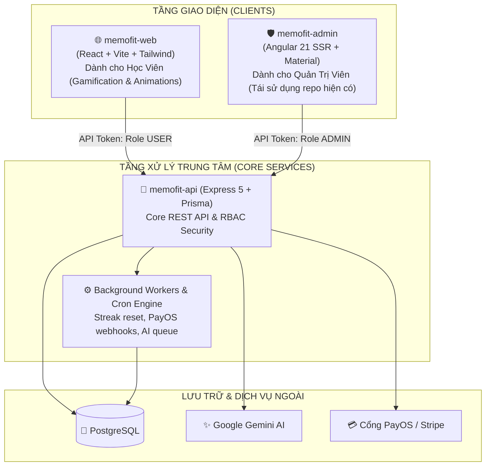
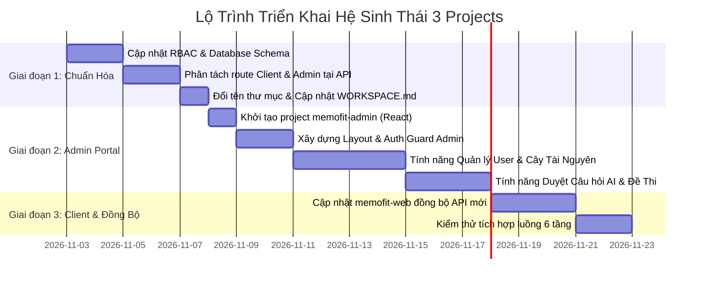

# Multi-Project Ecosystem Specification & Architecture Blueprint
# Hệ Sinh Thái Nền Tảng Học Ngôn Ngữ Memofit (3 Sub-Projects)

> **Trạng thái**: Draft / Architecture Specification  
> **Ngôn ngữ hỗ trợ (Giai đoạn 1)**: Tiếng Anh - Tiếng Việt (English - Vietnamese)  
> **Mô hình kiến trúc**: Multi-Project Monorepo (Shared Workspace Root)  
> **Tài liệu tham chiếu**: [WORKSPACE.md](file:///home/thnh/Documents/Projects/memofit/WORKSPACE.md), [system-flow-overview.md](file:///home/thnh/Documents/Projects/memofit/docs/01-architecture/system-flow-overview.md)

---

## 1. TỔNG QUAN TẦM NHÌN NỀN TẢNG (PLATFORM VISION)

Memofit là nền tảng học ngôn ngữ thông minh, lấy phương pháp Lặp lại ngắt quãng (Spaced Repetition - SM-2), công nghệ tạo câu hỏi tự động qua Trí tuệ nhân tạo (Google Gemini AI) và tổng hợp âm thanh giọng đọc chuẩn bản ngữ ngoại tuyến (Piper TTS via ONNX Runtime Web) làm hạt nhân.

Để đảm bảo tính bảo mật, tối ưu tải và chuyên môn hóa giao diện cho từng nhóm người dùng, toàn bộ hệ sinh thái được quy hoạch thành **3 sub-projects độc lập**:



---

## 2. QUY HOẠCH CẤU TRÚC THƯ MỤC 3 PROJECTS (PROJECT DIRECTORY BLUEPRINT)

Cấu trúc thư mục tại Workspace Root `./` được tổ chức như sau:

```text
memofit/
├── .agents/                        # AI Framework Skills, Rules & Scripts
├── docs/                           # Cây tài liệu hệ thống, kiến trúc & features
│   ├── architecture/               # Tài liệu thiết kế kiến trúc toàn hệ thống
│   ├── features/                   # Kế hoạch chi tiết của từng tính năng
│   └── rules/                      # Quy tắc hệ thống và ràng buộc kỹ thuật
├── memofit-web/                    # [DỰ ÁN 1] Web Client Học Viên (React + Vite + Animations)
├── memofit-admin/                  # [DỰ ÁN 2] Cổng Quản Trị Admin (Angular 21 - Tái sử dụng)
├── memofit-api/                    # [DỰ ÁN 3] Backend API & Worker Engine (Express 5)
├── WORKSPACE.md                    # Khai báo cấu hình phân vùng Workspace
└── AGENTS.md                       # Quy chuẩn vận hành AI Assistant
```

---

### 2.1. Cấu Trúc Thư Mục `memofit-web` (Client Web Học Viên - React + Vite)

Dự án mới xây dựng chuyên sâu về **Hoạt họa (Animations), Gamification và Học tương tác phong cách Duolingo**:

```text
memofit-web/
├── public/
│   ├── sfx/                        # Âm thanh hiệu ứng (correct.mp3, wrong.mp3, victory.mp3)
│   └── animations/                 # Lottie / Rive vector animations (mascot, streaks)
├── src/
│   ├── assets/                     # Icons, huy hiệu rank, hình ảnh minh họa
│   ├── components/                 # Reusable UI & Gamified Components
│   │   ├── common/                 # Button3D, ProgressBar, Modal, Confetti
│   │   ├── layout/                 # MainHeader, BottomNav, FloatingStreakWidget
│   │   └── roadmap/                # PathNode, SvgConnector, LockBadge, BossChest
│   ├── features/                   # Tính năng đóng gói theo domain
│   │   ├── auth/                   # Login, Register, OTP verification
│   │   ├── roadmap/                # Bản đồ lộ trình 5 Ranks Duolingo-style
│   │   ├── lesson/                 # Micro-learning Engine (Flashcard, Multiple Choice, Cloze)
│   │   ├── video/                  # Interactive Video Player (Dictation & Shadowing)
│   │   ├── writing/                # Phòng luyện viết câu theo 12 thì & ngữ pháp
│   │   ├── exam/                   # Phòng thi thử TOEIC bấm giờ
│   │   └── payment/                # Chọn gói học & quét mã VietQR PayOS
│   ├── hooks/                      # Custom hooks (useSound, useRoadmap, useSpeechRecognition)
│   ├── services/                   # Axios HTTP API client gọi tới /api/v1/client/*
│   ├── stores/                     # State management (Zustand: user, hearts, streak, sound)
│   ├── types/                      # TypeScript interfaces (Word, Question, Lesson, Rank)
│   ├── App.tsx                     # Định tuyến chính (React Router)
│   ├── main.tsx                    # React DOM entry
│   └── index.css                   # Tailwind CSS styling & keyframe animations
├── vite.config.ts
├── package.json
└── tsconfig.json
```

---

### 2.2. Cấu Trúc Thư Mục `memofit-admin` (Admin Portal - Angular 21)

Tái sử dụng và chuyển đổi mục đích từ thư mục `front-end/` hiện tại, tận dụng Angular Material và cấu trúc SSR/SPA có sẵn để phục vụ quản trị:

```text
memofit-admin/
├── src/
│   ├── app/
│   │   ├── components/             # Các màn hình quản trị
│   │   │   ├── auth/               # Đăng nhập Admin (/admin/login)
│   │   │   ├── dashboard/          # Thống kê số lượng học viên, doanh thu, tải hệ thống
│   │   │   ├── users/              # Quản lý học viên, xem tiến độ, khóa/mở tài khoản
│   │   │   ├── roadmap-manager/    # Cấu hình 5 Ranks, 10 Topics, gán bài học
│   │   │   ├── vocabulary-manager/ # Kho từ vựng mẫu (Master Dictionary)
│   │   │   ├── video-manager/      # Tải lên video, cắt timestamp phụ đề Dictation
│   │   │   ├── question-approval/  # Duyệt và chỉnh sửa câu hỏi do Gemini AI tạo
│   │   │   ├── exam-manager/       # Tạo đề thi TOEIC, cấu hình thời gian làm bài
│   │   │   └── transaction-logs/   # Nhật ký giao dịch PayOS, lịch sử kích hoạt gói
│   │   ├── guards/                 # AdminAuthGuard (kiểm tra token role = 'ADMIN')
│   │   ├── interceptors/           # HTTP Interceptor gắn JWT Token Admin
│   │   ├── models/                 # TypeScript interfaces cho quản trị
│   │   ├── services/               # HTTP client gọi tới /api/v1/admin/*
│   │   ├── app.routes.ts           # Khai báo Routing độc lập cho Admin
│   │   └── app.ts                  # Root Component
│   ├── index.html
│   ├── main.ts
│   └── styles.css                  # Tailwind CSS + Angular Material
├── angular.json
├── package.json
└── tsconfig.json
```

---

### 2.3. Cấu Trúc Thư Mục `memofit-api` (Backend API & Worker - Express 5)

Kế thừa và chuẩn hóa từ `back-end/` hiện tại, bổ sung module Admin và Worker:

```text
memofit-api/
├── prisma/
│   ├── schema.prisma               # Schema cơ sở dữ liệu quan hệ (PostgreSQL)
│   └── migrations/                 # Lịch sử migration cơ sở dữ liệu
├── src/
│   ├── config/                     # Cấu hình DB, JWT, Gemini AI, Swagger, Mailer
│   ├── controllers/
│   │   ├── client/                 # Controllers phục vụ Học viên (memofit-web)
│   │   │   ├── auth.controller.js
│   │   │   ├── vocabularies.controller.js
│   │   │   ├── practice.controller.js
│   │   │   ├── exams.controller.js
│   │   │   └── dashboard.controller.js
│   │   └── admin/                  # Controllers phục vụ Quản Trị Viên (memofit-admin)
│   │       ├── user_manager.controller.js
│   │       ├── resource_category.controller.js
│   │       ├── question_approval.controller.js
│   │       ├── exam_config.controller.js
│   │       └── audit_log.controller.js
│   ├── middleware/
│   │   ├── auth.middleware.js      # Xác thực Access Token
│   │   ├── role.middleware.js      # RBAC: Kiểm tra quyền (USER vs ADMIN vs SUPER_ADMIN)
│   │   ├── validate.middleware.js  # Kiểm tra dữ liệu đầu vào bằng Zod
│   │   └── error.middleware.js     # Bắt lỗi toàn cục và trả về chuẩn JSON Envelope
│   ├── routes/
│   │   ├── client/                 # Định tuyến cho memofit-web (/api/v1/client/*)
│   │   ├── admin/                  # Định tuyến cho memofit-admin (/api/v1/admin/*)
│   │   └── index.js                # Router tổng hợp
│   ├── services/
│   │   ├── ai.service.js           # Giao tiếp với Google Gemini API
│   │   ├── sm2.service.js          # Thuật toán tính ngày ôn tập SuperMemo-2
│   │   ├── mail.service.js         # Gửi OTP và thông báo hệ thống
│   │   └── excel.service.js        # Nhập / xuất từ vựng qua file Excel
│   ├── workers/                    # Xử lý các tác vụ ngầm (Background Jobs)
│   │   ├── streak_worker.js        # Kiểm tra và cập nhật trạng thái streak hàng ngày
│   │   └── ai_queue_worker.js      # Xử lý hàng đợi sinh câu hỏi số lượng lớn
│   ├── validators/                 # Zod Schemas cho Client và Admin
│   └── app.js                      # Khởi tạo Express Server & Mount Routers
├── uploads/                        # Thư mục lưu file tạm, hình ảnh
├── package.json
└── .env
```

---

## 3. MA TRẬN CHỨC NĂNG CHI TIẾT (PROJECT FEATURE MATRIX)

### 3.1. Dự Án `memofit-web` — Hệ Sinh Thái Học Tập Gamification Phong Cách Duolingo

Mục tiêu trọng tâm của `memofit-web` là nền tảng học tiếng Anh & luyện thi TOEIC kết hợp **Gamification (Game hóa học tập)** tương tự Duolingo với hiệu ứng âm thanh, chuyển động sinh động (Animations) và cây tiến độ từng bước.

#### 🏛️ Trụ Cột 1: Lộ Trình Tiến Hóa Duolingo-Style (5 Cấp Bậc / Ranks)
Toàn bộ hành trình học viên được chia thành 5 Rank danh giá:
1. **Rank 1: Cơ Bản (Bronze / Starter)**: Phát âm IPA, từ vựng sinh hoạt đời thường, các thì cơ bản (hiện tại đơn, quá khứ đơn).
2. **Rank 2: Trung Cấp (Silver / Intermediate)**: 600 từ vựng TOEIC căn bản, từ vựng công sở, câu bị động, Part 1 & 2 TOEIC.
3. **Rank 3: Nâng Cao (Gold / Advanced)**: Từ vựng đàm phán, hợp đồng, câu điều kiện, liên từ, Part 5 & 6 TOEIC.
4. **Rank 4: Cao Thủ (Diamond / Master)**: Paraphrasing chuyên sâu, bẫy nghe Part 3 & 4, bài đọc kép Part 7 TOEIC.
5. **Rank 5: Thách Đấu (Challenger / Legend)**: Luyện Full đề thi TOEIC 200 câu tốc độ cao, xử lý văn bản phức tạp.

* **Cấu trúc phân cấp trong mỗi Rank**:
  * Mỗi Rank gồm khoảng **10 Topics (Chủ đề)** lớn.
  * Mỗi Topic gồm các **Steps / Nodes (Bài học nhỏ 3 - 5 phút)** theo dạng cây hành trình (S-curve path):
    * *Node 1 (Khám phá)*: Làm quen 5 từ vựng mới bằng Flashcard mini.
    * *Node 2 (Phản xạ)*: Trắc nghiệm nghe & nhận diện từ.
    * *Node 3 (Ứng dụng)*: Ghép từ thành câu / Điền từ vào chỗ trống.
    * *Node 4 (Vượt ải / Boss Checkpoint)*: Bài kiểm tra tổng hợp đạt $\ge 80\%$ để nhận cúp vàng và mở khóa Topic tiếp theo (kèm hiệu ứng pháo hoa Confetti và Mascot chúc mừng).

#### ✍️ Trụ Cột 2: Luyện Viết & Cấu Trúc Ngữ Pháp (Writing & Grammar Mastery)
Không chỉ học từ vựng rời rạc, nền tảng cung cấp phòng luyện viết câu theo ngữ pháp:
* **Các chủ điểm ngữ pháp trọng tâm**:
  * *Hệ thống 12 thì (Tenses)*: Hiện tại đơn, tiếp diễn, hoàn thành, quá khứ, tương lai.
  * *Câu điều kiện (Conditionals)*: Type 1, Type 2, Type 3, Mixed.
  * *Câu bị động (Passive Voice)*: Nhận diện tác nhân, chuyển đổi chủ động $\rightarrow$ bị động.
  * *Mạo từ & Lượng từ (Articles & Quantifiers)*: Quy tắc dùng `a`, `an`, `the` và danh từ đếm được/không đếm được.
* **Hình thức bài tập**:
  * *Sắp xếp thẻ từ (Word Tile Ordering)*: Chạm/kéo các thẻ từ rời rạc để xếp thành câu đúng ngữ pháp.
  * *Chuyển đổi câu (Sentence Transformation)*: Viết lại câu giữ nguyên nghĩa với từ gợi ý.
  * *Sửa lỗi sai (Error Spotting)*: Tìm và sửa lỗi ngữ pháp trong câu văn môi trường công sở.

#### 🎥 Trụ Cột 3: Học Qua Video Tương Tác (Interactive Video Learning)
* **Chế độ Dictation (Nghe chép chính tả)**: Video phát 1 câu $\rightarrow$ dừng lại $\rightarrow$ Học viên gõ lại $\rightarrow$ Chấm Text Diff (từ đúng xanh lá, từ sai gạch đỏ).
* **Chế độ Shadowing (Nhại giọng / Luyện nói)**: Video phát âm mẫu $\rightarrow$ Học viên thu âm nhại theo $\rightarrow$ Chấm điểm tương đồng phát âm (%).

#### 📚 Trụ Cột 4: Học Từ Vựng Đa Phương Thức (Multi-Modal Vocabulary)
* **Từ vựng hệ thống & Tự sưu tầm (Personal Collections)**.
* **4 Cách thức học**: Flashcard 3D (SM-2 Spaced Repetition), Trắc nghiệm phản xạ, Điền từ vào câu (Cloze test), Câu hỏi chuẩn format TOEIC Part 5 & 6.

#### 📝 Trụ Cột 5: Luyện Đề & Thi Thử TOEIC (TOEIC Exam Simulator)
* **Mini Test (15 - 30 phút)** & **Full Test (2 tiếng - 200 câu)**: Đồng hồ đếm ngược, quy đổi thang điểm 10 - 990 TOEIC.

#### 💳 Trụ Cột 6: Hệ Thống Đăng Ký Gói & Thanh Toán (Monetization & Payments)
* **Mô hình gói học**:
  * *Gói Miễn Phí (Freemium)*: Giới hạn 3 bài học/ngày, học bộ từ vựng cơ bản.
  * *Gói Thành Viên Pro (Subscription)*: Không giới hạn bài học, mở khóa toàn bộ video Dictation/Shadowing, AI tự tạo đề thi không giới hạn.
* **Tích hợp cổng thanh toán Sandbox chuẩn Developer**:
  * **PayOS (Việt Nam)**: Tạo mã VietQR thanh toán tự động, Webhook xác nhận giao dịch trong 1 giây, Sandbox test cực mượt cho developer.
  * **Stripe (Quốc tế)**: Hỗ trợ thẻ tín dụng Visa/Mastercard/Apple Pay, môi trường test CLI & thẻ test phong phú.

---

### 3.2. Dự Án `memofit-admin` (Dành cho Quản Trị Viên)

| Nhóm Nghiệp Vụ | Tên Chức Năng | Mô Tả Chi Tiết |
|---|---|---|
| **Xác thực Admin** | Đăng nhập bảo mật | Xác thực tài khoản có phân quyền `role = 'ADMIN' \| 'SUPER_ADMIN'`. |
| **Quản lý Người Dùng** | Danh sách tài khoản | Tìm kiếm theo tên/email, lọc theo trạng thái kích hoạt, ngày đăng ký. |
| | Chi tiết học viên | Xem tiến độ học tập, tổng từ đã học, lịch sử streak, bài thi đã làm. |
| | Khóa / Mở tài khoản | Kích hoạt hoặc vô hiệu hóa tài khoản vi phạm hoặc có dấu hiệu bất thường. |
| **Cây Thư Mục & Tài Nguyên** | Phân cấp danh mục | Quản lý cây danh mục hệ thống: Cấp độ (A1, A2, B1, B2, C1, C2) $\rightarrow$ Chủ đề. |
| | Master Dictionary | Kho từ vựng mẫu chuẩn hóa của nền tảng mà học viên có thể clone về học. |
| | Kiểm duyệt nội dung | Rà soát các bộ từ vựng công khai do người dùng chia sẻ lên cộng đồng. |
| **Ngân Hàng Câu Hỏi & AI** | Phê duyệt câu hỏi AI | Xem lại các câu hỏi và đáp án do Gemini tự sinh; bấm Duyệt (`is_approved = true`) hoặc chỉnh sửa. |
| | Quản lý đề thi (Exams) | Tạo đề thi chính thức, gán câu hỏi vào đề, đặt thời gian làm bài, cấu hình độ khó. |
| **Vận Hành & Sự Cố** | Bảng điều khiển vận hành | Dashboard tổng quan: Tổng người dùng mới, tỷ lệ hoàn thành bài học, tải API. |
| | Nhật ký hệ thống (Logs) | Xem danh sách các lỗi HTTP 500, lỗi gọi Gemini API để xử lý sự cố kịp thời. |

---

### 3.3. Dự Án `memofit-api` (Xử Lý Trung Tâm & Background Tasks)

| Nhóm Nhiệm Vụ | Trách Nhiệm Kỹ Thuật | Chi Tiết Thực Thi |
|---|---|---|
| **Cổng Xác Thực & RBAC** | Phân quyền 2 tầng | Middleware xác thực JWT, giải mã `role` và chặn truy cập trái phép vào route Admin. |
| **Thuật Toán SM-2** | Tính toán khoảng cách nhớ | Tính lại $EF'$ (Ease Factor) và $Interval$ theo phản hồi điểm 0 - 5 của học viên. |
| **Tích Hợp Trí Tuệ Nhân Tạo** | Google Gemini Generator | Xây dựng prompt có cấu trúc (Structured Outputs) để sinh câu hỏi trắc nghiệm và câu ví dụ chuẩn JSON. |
| **Background Workers** | Streak Maintenance | Cronjob chạy định kỳ rà soát `last_active_date` để reset hoặc bảo lưu streak của người dùng. |
| | Dọn dẹp dữ liệu | Quét các token OTP hết hạn trong bảng `password_resets`. |
| **Chuẩn Hóa Dữ Liệu** | Validation & Response Envelope | Mọi payload qua Zod; response đồng bộ `{ status, data, message }`. |

---

## 4. QUY ƯỚC BẢO MẬT & MỞ RỘNG CƠ SỞ DỮ LIỆU (DATABASE & RBAC DESIGN)

### 4.1. Phân Quyền RBAC (Role-Based Access Control)
Cập nhật bảng `users` trong PostgreSQL:

```prisma
enum user_role {
  USER          // Học viên học tập trên memofit-web
  MODERATOR     // Kiểm duyệt viên nội dung, câu hỏi
  ADMIN         // Quản trị viên hệ sinh thái memofit-admin
  SUPER_ADMIN   // Toàn quyền cấu hình hệ thống
}
```

* **Route Prefix Học Viên**: `/api/v1/client/*` (Yêu cầu Token `USER` trở lên).
* **Route Prefix Quản Trị**: `/api/v1/admin/*` (Bắt buộc Token có `role` thuộc `['ADMIN', 'SUPER_ADMIN']`).

---

### 4.2. Mở Rộng Schema Cho Lộ Trình & Video Học Tập (Schema Expansion)

Để hỗ trợ học theo lộ trình và học qua video tương tác (Dictation & Shadowing), cơ sở dữ liệu bổ sung các thực thể sau:

```prisma
// Lộ trình học (TOEIC Foundation, 450-650, 650-850+)
model learning_paths {
  id          Int            @id @default(autoincrement())
  title       String         @db.VarChar(255)
  target_band String         @db.VarChar(50) // '0-450', '450-650', '650-850+'
  description String?
  order_index Int            @default(0)
  stages      path_stages[]
}

// Chặng học / Unit trong lộ trình
model path_stages {
  id              Int            @id @default(autoincrement())
  path_id         Int
  title           String         @db.VarChar(255)
  order_index     Int            @default(0)
  collection_id   Int?           // Bộ từ vựng liên kết
  video_id        Int?           // Video luyện nghe liên kết
  exam_id         Int?           // Bài checkpoint test
  path            learning_paths @relation(fields: [path_id], references: [id], onDelete: Cascade)
}

// Video tương tác (Dictation & Shadowing)
model interactive_videos {
  id          Int               @id @default(autoincrement())
  title       String            @db.VarChar(255)
  video_url   String            @db.VarChar(500)
  duration_s  Int?
  level       String?           // 'A2', 'B1', 'B2'
  category    String?           // 'Conversation', 'News', 'TOEIC Listening'
  subtitles   video_subtitles[]
}

// Phụ đề theo mốc thời gian để làm bài tập chép chính tả & nhại giọng
model video_subtitles {
  id           Int                @id @default(autoincrement())
  video_id     Int
  start_time_s Float
  end_time_s   Float
  text_en      String
  text_vi      String?
  video        interactive_videos @relation(fields: [video_id], references: [id], onDelete: Cascade)
}
```

---

## 5. KẾ HOẠCH TRIỂN KHAI THEO GIAI ĐOẠN (IMPLEMENTATION ROADMAP)



1. **Bước 1**: Rà soát và cập nhật Schema cơ sở dữ liệu (`prisma/schema.prisma`), bổ sung Enum `user_role` và phân tách rõ ràng các Controller cho Client và Admin.
2. **Bước 2**: Thực hiện đổi tên và cập nhật cấu hình điều hướng Workspace [WORKSPACE.md](file:///home/thnh/Documents/Projects/memofit/WORKSPACE.md).
3. **Bước 3**: Khởi tạo project `memofit-admin` bằng React + Vite, thiết lập UI Component System cho Admin.
4. **Bước 4**: Triển khai từng phân hệ quản trị trên Admin và đồng bộ hoàn thiện với `memofit-web`.
