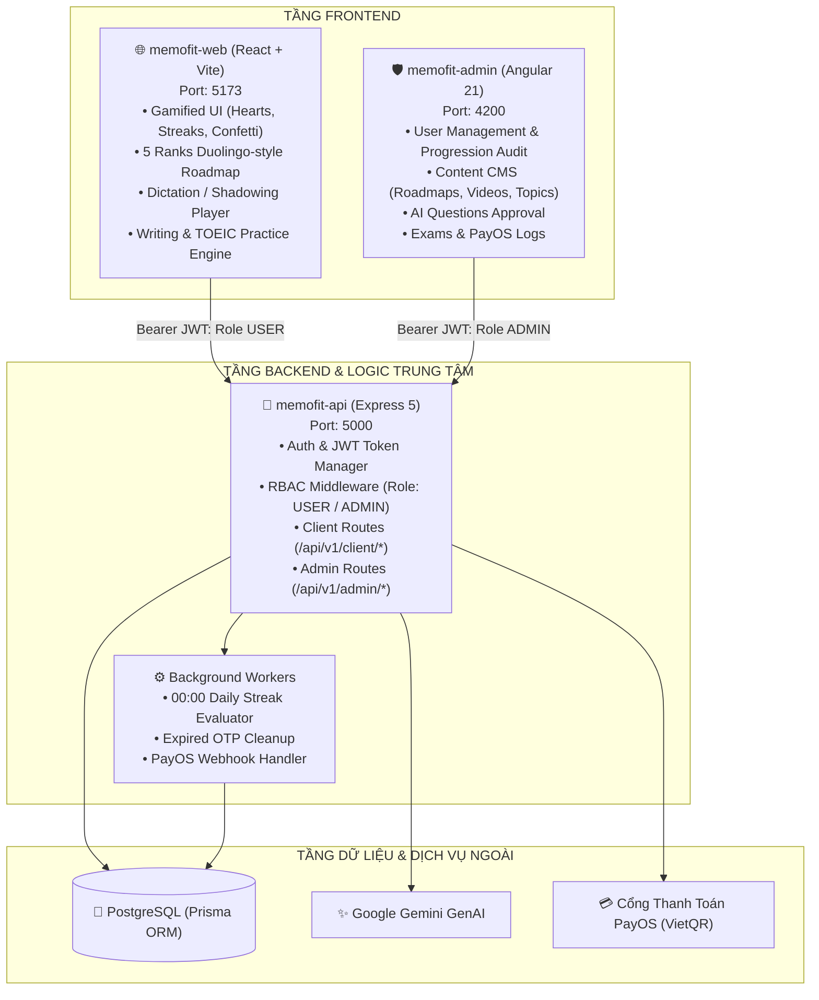
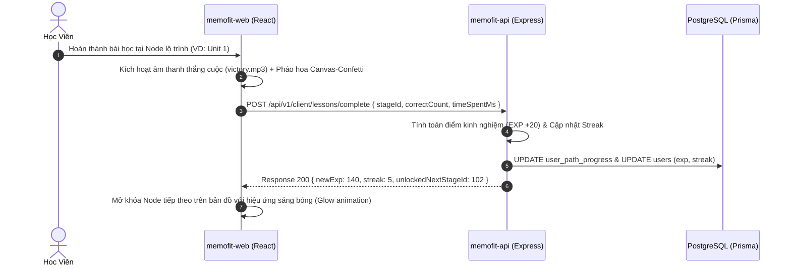
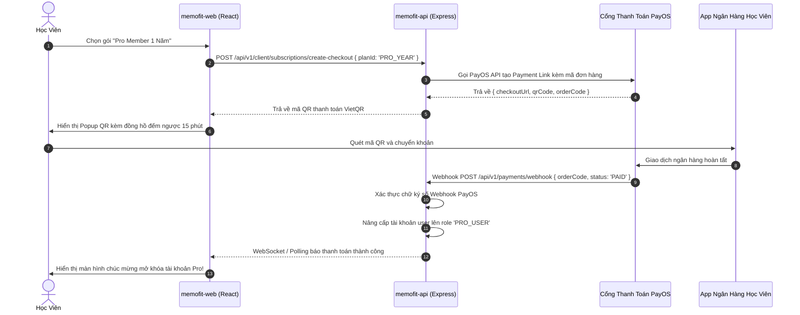

# Technical Specification: [FEAT-SYSTEM-001] - Tái Cấu Trúc Hệ Sinh Thái 3 Projects & Khởi Tạo Nền Tảng Học Tiếng Anh Duolingo-Style

- **Mã tính năng**: `FEAT-SYSTEM-001`
- **Tài liệu kế hoạch**: [plan.md](file:///home/thnh/Documents/Projects/memofit/docs/features/system/FEAT-SYSTEM-001-tai-cau-truc-he-sinh-thai-3-project-va-khoi-tao-nen-tang-hoc-tieng-anh/plan.md)

---

## 1. Sơ Đồ Kiến Trúc Hệ Sinh Thái 3 Dự Án (Ecosystem Architecture)



---

## 2. Luồng Xử Lý Nghiệp Vụ Cốt Lõi (Core Sequence Flows)

### 2.1. Luồng Học Viên Hoàn Thành Bài Học Vượt Ải (Lesson Completion & Gamification Flow)



### 2.2. Luồng Thanh Toán Mua Gói Học Qua VietQR PayOS (Payment Flow)



---

## 3. Đặc Tả Hợp Đồng API (API Contracts)

### 3.1. Phân Nhánh API Học Viên (`/api/v1/client/*`)

* `GET /api/v1/client/roadmap`: Trả về toàn bộ cây lộ trình 5 Ranks, danh sách Topics và trạng thái từng Node của học viên.
* `GET /api/v1/client/lessons/:id`: Trả về dữ liệu bài học (danh sách từ vựng, câu hỏi trắc nghiệm, bài tập viết).
* `POST /api/v1/client/lessons/:id/submit`: Nộp bài làm, tính điểm SM-2 và nhận thưởng EXP.
* `GET /api/v1/client/videos`: Danh sách video tương tác phục vụ Dictation & Shadowing.
* `GET /api/v1/client/videos/:id/subtitles`: Dữ liệu phụ đề theo mốc thời gian để làm bài chép chính tả.
* `POST /api/v1/client/subscriptions/create-checkout`: Khởi tạo đơn hàng thanh toán VietQR PayOS.

### 3.2. Phân Nhánh API Quản Trị (`/api/v1/admin/*`) — Yêu cầu Role `ADMIN`

* `GET /api/v1/admin/users`: Danh sách học viên, phân trang, lọc theo trạng thái tài khoản.
* `PUT /api/v1/admin/users/:id/status`: Khóa hoặc mở khóa tài khoản học viên.
* `POST /api/v1/admin/roadmaps/topics`: Tạo Topic mới cho một Rank.
* `POST /api/v1/admin/videos`: Tải lên video mới kèm file phụ đề VTT/SRT.
* `GET /api/v1/admin/questions/pending`: Danh sách câu hỏi AI tạo đang chờ duyệt.
* `PUT /api/v1/admin/questions/:id/approve`: Duyệt câu hỏi đưa vào kho đề chính thức.
* `GET /api/v1/admin/transactions`: Lịch sử giao dịch thanh toán gói học qua PayOS.

---

## 4. Đặc Tả Cơ Sở Dữ Liệu Bổ Sung (Prisma Schema Additions)

```prisma
enum user_role {
  USER
  PRO_USER
  MODERATOR
  ADMIN
  SUPER_ADMIN
}

// Bảng đơn hàng thanh toán gói học
model subscription_orders {
  id              Int       @id @default(autoincrement())
  user_id         Int
  order_code      BigInt    @unique
  plan_type       String    @db.VarChar(50) // 'MONTHLY', 'YEARLY', 'LIFETIME'
  amount          Int
  status          String    @default("PENDING") @db.VarChar(50) // 'PENDING', 'PAID', 'CANCELLED'
  payos_payment_link_id String? @db.VarChar(255)
  created_at      DateTime  @default(now()) @db.Timestamp(6)
  paid_at         DateTime? @db.Timestamp(6)
  users           users     @relation(fields: [user_id], references: [id], onDelete: Cascade)
}
```
